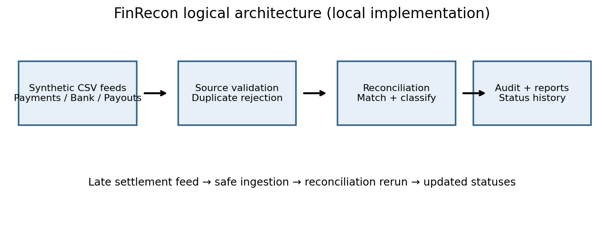
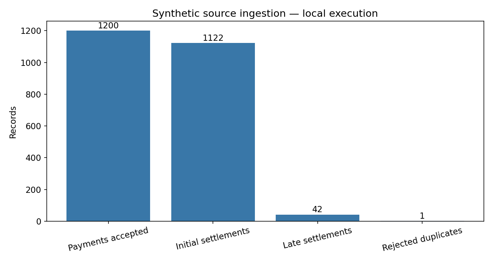
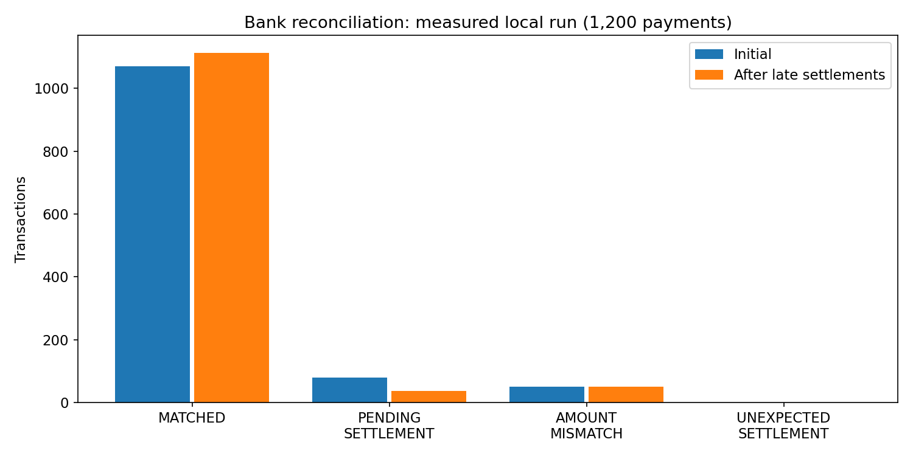
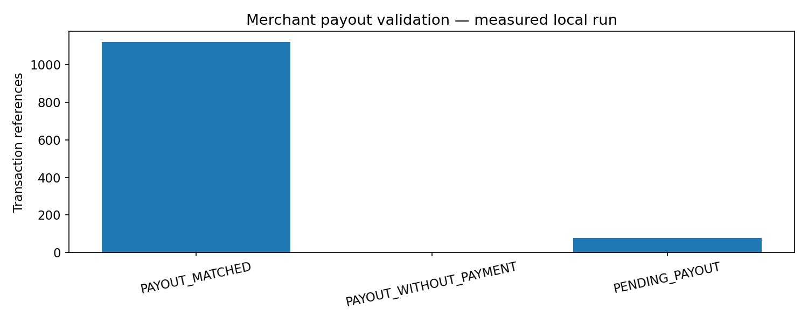
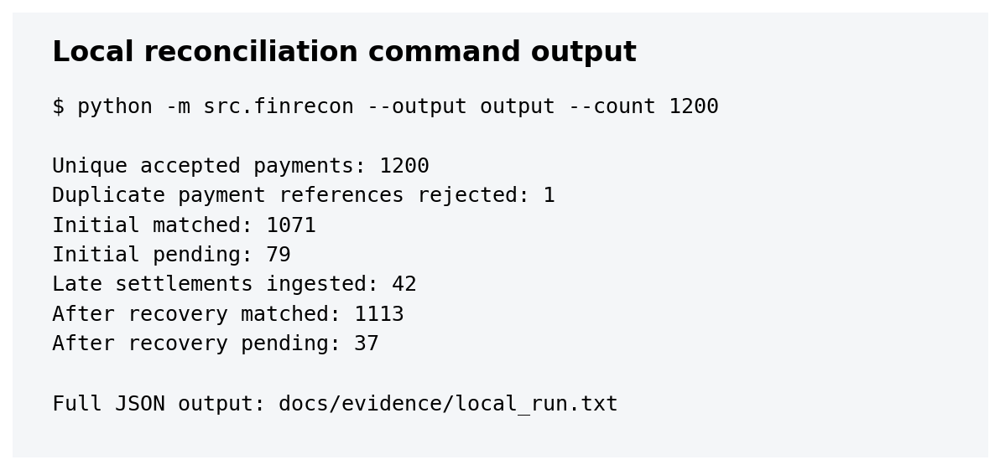
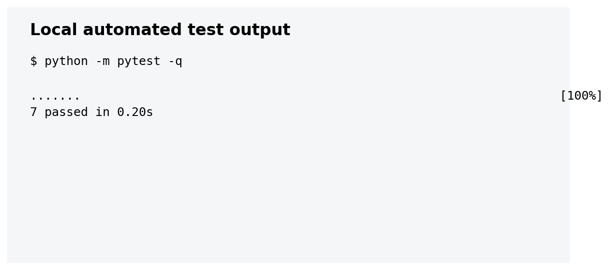

# FinRecon · Financial Reconciliation

**Python · SQL/SQLite · PySpark/Delta Lake (Azure-ready)**  
*A small, reproducible payment reconciliation project built around a common finance-team headache: numbers that don't agree.*

## The problem

A payment platform receives three different feeds: customer payments, bank settlements and merchant payouts. Missing or late bank records, wrong amounts and duplicate references make daily reconciliation slow and error-prone. FinRecon matches the feeds, explains exceptions and safely reruns when late settlements arrive.

**What I built:** a locally executable three-way reconciliation workflow, deterministic synthetic EUR data, exception classification, run history and tests.

## At a glance

| | |
|---|---|
| Business goal | Identify unmatched money and make exceptions easier to investigate |
| Sources | Payments, bank settlements, merchant payouts, late settlement batch |
| Matching | `transaction_id`, amounts in **integer cents**, currency and merchant |
| Local stack | Python + SQLite + pytest |
| Cloud code | Azure Databricks + PySpark + Delta Lake (unverified) |
| Sample fee rule | Expected merchant payout = payment − €1.00; **synthetic assumption** |



## What happens in the pipeline?

1. **Ingest:** generate and load three synthetic payment-system feeds.
2. **Validate:** reject duplicate payment IDs and flag missing/mismatched records.
3. **Reconcile:** classify **bank settlements and merchant payouts separately**. A payment may be bank-matched but payout-pending.
4. **Recover:** ingest 42 late settlements and rerun without duplicating accepted payments.
5. **Audit:** save current statuses, rejected records and run history.


*Actual synthetic-data counts from local execution.*

## What did the run show?

I ran the local pipeline with **1,200 unique synthetic payments**. After the late feed arrived, 42 pending bank settlements became matched.

| Bank status | Before | After late feed |
|---|---:|---:|
| Matched | 1,071 | 1,113 |
| Pending settlement | 79 | 37 |
| Amount mismatch | 50 | 50 |
| Unexpected settlement | 1 | 1 |



Payouts are checked independently: **1,121 matched, 79 pending and 1 payout without a payment** in the synthetic run.



**Tests:** 13 passed locally. These results are reproducible synthetic-data results, not production or Azure measurements.

<details>
<summary>See local execution and test evidence</summary>




Raw records: [`docs/evidence/`](docs/evidence/).
</details>


## Run it locally (macOS / VS Code)

```bash
python3 -m venv .venv
source .venv/bin/activate
python -m pip install -r requirements.txt
python -m pytest -q
python -m src.finrecon --output output --count 1200
```

Look in `output/reports/` for the summary, reconciliation rows, rejected records and run history. To try the Azure notebooks, see [`docs/azure_setup.md`](docs/azure_setup.md); a Databricks workspace, Unity Catalog permissions and compute are required.

## Project files

- [`src/finrecon.py`](src/finrecon.py) — local data generator, matching and recovery
- [`notebooks/`](notebooks/) — Delta ingestion, three-way matching and late-arrival merge
- [`tests/`](tests/) — repeatability and financial-rule tests
- [`docs/project_specification.md`](docs/project_specification.md) — full requirements and assumptions
- [`docs/engineering_decisions.md`](docs/engineering_decisions.md) — trade-offs and known limits
- [`screenshots/`](screenshots/) — local result images; Azure screenshots can be added after a real run


